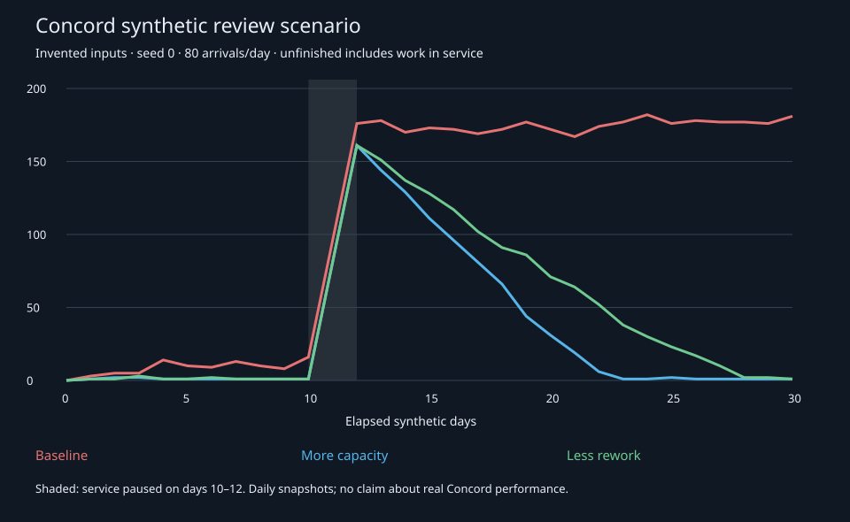

# Simulation and resilience

This study uses an **invented queue model**, not measurements of a running Concord
deployment. The experiment was conducted on September 30, 2026; this maintained
edition preserves its final corrected source, selected results and limitations.
It demonstrates an evaluation method and suggests questions for relevant subsystems.
It does not select a scheduler, staffing ratio, service target or implementation.
No decision change is made here.

## Model and assumptions

A single pooled first-in, first-out (FIFO) server receives 80 evenly spaced requests
per day for 30 days: 2,400 arrivals over 720 hours. Each service attempt has a constant
duration. A request that needs rework rejoins the back of the queue. Service pauses
on elapsed days 10–12, or hours 240–288, while arrivals continue. Interrupted work
keeps its remaining service time. The queue starts empty.

The three scenarios vary attempt capacity and the probability of rework. Each runs
with the same 50 fixed seeds, numbered 0–49. A reproducible SHA-256 draw keyed by
seed, request and attempt determines rework. The implementation orders an arrival
before a completion at an exact tie; rework from that completion then joins the
tail. Internal event times use exact fractions, with decimal conversion for export.

| Scenario | Attempts per day | Rework probability | Median unfinished at day 30 | Observed range |
| --- | ---: | ---: | ---: | ---: |
| Baseline | 100 | 20% | 167 | 130–217 |
| More capacity | 120 | 20% | 1 | 1–4 |
| Less rework | 100 | 10% | 1 | 1–16 |

The range is the minimum and maximum across those 50 runs, **not a confidence
interval**. One final unfinished request can be ordinary endpoint work: in the
no-rework check, the last arrival is at hour 719.85 and completes at 720.09, beyond
the horizon. The chart below uses seed 0; its lines are daily snapshots, not ensemble
medians or a continuous reconstruction of every event.



## What the model shows

### Recovery capacity differs from ordinary throughput

Under these assumptions, saturated expected completion capacity is attempts per
day multiplied by one minus the rework probability. The baseline therefore has
expected capacity of 80 completions per day, equal to incoming demand. It has no
expected surplus to clear an outage backlog. Random variation still affects finite
runs; equal expected rates do not guarantee a stable queue.

The higher-capacity scenario has expected completion capacity of 96 per day. The
lower-rework scenario has 90 per day. Both substantially reduce unfinished work in
this experiment. They do not establish a universal 20% reserve requirement or an
appropriate recovery deadline for Concord.

### Rework has capacity and quality consequences

Repeated work consumes attempts that could otherwise complete new requests. The
model exposes that pressure but assumes that reducing rework is free: it does not
model intervention effort, quality effects or cost. It cannot select between adding
capacity and reducing rework. A throughput improvement alone would not justify
removing required review, authorization or procedural safeguards.

### Completed-only timing omits waiting work

For baseline seed 0, 2,219 of 2,400 requests complete. Their 95th-percentile
arrival-to-completion time is 84.72 hours. The oldest unfinished request is already
196.05 hours old, about 8.2 days. It is absent from the completed-turnaround
distribution.

The summary therefore retains unfinished count and age alongside completed
turnaround, throughput and daily counts. Turnaround includes queueing, service,
rework and outage. Even these measures do not establish an absence of starvation
or procedural unfairness. Any real-system grouping or measurement would also need
to preserve its authorized data boundaries.

### Pause and resume need explicit accounting

The model preserves queued and interrupted requests and resumes without duplicate
completion. Its checks assert that arrivals equal completions plus unfinished work,
each request completes at most once, and finished attempts equal completions plus
reworks. These are bounded model invariants, not tests of Concord's authorization,
audit infrastructure or domain integration.

[CON-045 and CON-046](../../DECISIONS.md#CON-045) remain the authority for admitted
protected operations: this generic queue model does not cancel approved scope or
substitute an ordinary retry rule for the required audit pause/resume behavior.

### Event ordering can change discrete outcomes

The September 30 report records a correction from floating-point internal event
times to exact fractions after a simultaneous-event ordering discrepancy. The
final source includes a regression at 1.35 hours where arrival must precede rework.
This supports declaring and testing tie ordering, outage boundaries, initial state
and random draws in discrete-event models. It is not a requirement to use fractions
for every numerical calculation in Concord.

### Variation within a model is not validation of its assumptions

Multiple seeds explore variation within the specified model. They do not validate
the invented arrival pattern, constant service time or rework assumptions against
reality. Matching a daily unfinished count to a no-outage run also does not prove
identical request state or an exact recovery time. For seed 0, the first such daily
matches are day 23 for more capacity and day 29 for less rework; the baseline has no
match after day 12 within the horizon. These values are count comparisons only.

A persistent backlog is a scenario outcome, not a failure of the simulator's checks.
Passing those checks is not production acceptance or evidence that any Concord
subsystem actually has the modeled problem.

## Inspect and reproduce

The public evidence is deliberately small and directly inspectable:

- [simulate.py](synthetic-queue/simulate.py) is the complete final simulator, copied
  without changes. It uses only Python's standard library and performs no network
  calls or Concord integration.
- [results-summary.json](synthetic-queue/results-summary.json) retains every model,
  parameter, seed and ensemble field plus the seed-0 summaries and daily snapshots.
  The full per-request records and event logs are generated by the simulator.
  `historical_checks_reported` preserves the original check list and is not itself
  a claim that a reader has run those checks.
- [backlog.svg](synthetic-queue/backlog.svg) is the original seed-0 chart.

From the repository root, copy the source into a new scratch directory before
running it, because it writes `results.json` and `backlog.svg` beside itself:

```sh
study_dir=$(mktemp -d)
cp docs/research/synthetic-queue/simulate.py "$study_dir/simulate.py"
python3 "$study_dir/simulate.py"
sha256sum "$study_dir/results.json" "$study_dir/backlog.svg"
```

No package installation is needed. The command prints the bounded check results,
representative summaries and ensemble results; the scratch folder also receives
the complete results. Keep that directory if you want to inspect the generated
per-request events. It is separate from the retained source and chart.

Expected SHA-256 values for the exact retained source and generated artifacts:

| Artifact | SHA-256 |
| --- | --- |
| `simulate.py` | `0abf97d5dd7408304cab51b004b00123a240034bf406b35003b9bdc02993f2c3` |
| Full generated `results.json` | `8b64d1639732c34d07d3e679f4c678962ebfb723a45da9b401441e3d1d160a6c` |
| `backlog.svg` | `0d92ef1c424101776320b4aeecbc569535ff6ea4e5e6c208d5b45a054ca0299d` |

The source was rerun locally on October 22, 2026 using Python's standard library.
All included checks passed, and the complete generated results and chart matched
the retained artifacts byte for byte. This is an author-side reproduction of the
bounded experiment, not qualifying independent acceptance or a new implementation
test of Concord.

## Limits and possible applications

Inputs are entirely invented. The model includes no bursty demand, priorities,
staff qualifications, agent adaptation, protected data, strategic behavior,
intervention costs or real-world calibration. Generalized parameter validation and
production fairness were not established. No Wolfram application is required or
used by this study.

For a future evaluation of ingestion, publication, review or service queues, useful
questions are what enters, what consumes capacity, what repeats, what remains
pending, and what can lawfully leave. Compare explicit alternatives, exercise
interruptions and overload, and include unfinished work and tradeoffs. Applicability
to each real subsystem requires its own permitted observations and validation;
this page does not dispatch work or select operating policy.

The maintained record is derived from the September 30 study and its project
write-up at commit `29c2b2bba35213264466eb399e03adbb22d5b7b3`. Original source and
historical review evidence are retained privately; the selected runnable source,
chart and compact results above are sufficient to inspect and reproduce the
quantitative claims without access to private accounts.
